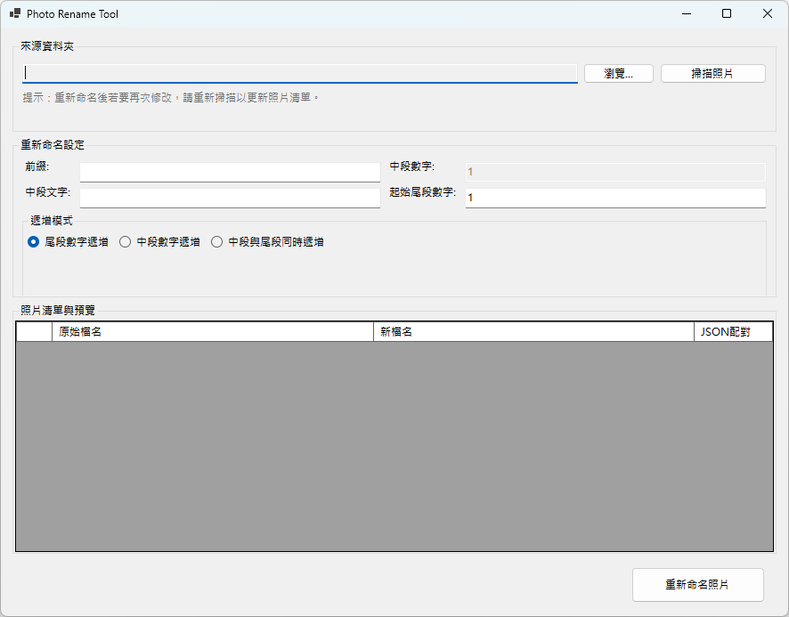

# PhotoRename — Batch Photo Renaming Tool

使用 C# / .NET 10 與 Windows Forms 開發的照片批次重新命名工具。將資料夾中的照片與同名 JSON 標記檔配對，依命名規則產生預覽，再一起更名，減少逐一處理檔案時的配對負擔。

本專案源自既有的 [Python 工具](legacy/photo_rename.py)，以 C# 重新實作圖形化操作流程，分離介面與核心邏輯，並加入 xUnit 測試、目標衝突檢查及失敗復原處理。開發採用 AI Agent 協作，分工與驗證方式見文末。

## 使用介面



## 核心功能

| 使用情境 | 目前實作 |
|---|---|
| 圖片及 JSON 配對 | 掃描所選資料夾第一層的 JPG、JPEG、PNG，圖片副檔名不分大小寫；依檔名排序，尋找同名 JSON。沒有 JSON 的圖片仍可處理，不修改 JSON 內容。 |
| 批次命名與預覽 | 顯示原始檔名、新檔名與 JSON 配對狀態；調整設定後更新預覽，執行時同步更名圖片與配對 JSON。 |
| 自訂編號及遞增模式 | 輸入前綴、中段數字、中段文字與起始尾段數字，選擇尾段、中段或兩者同時遞增。 |
| 衝突處理與失敗復原 | 每組更名前檢查圖片及 JSON 目標是否已存在；衝突時回報失敗。移動過程使用暫存檔名，部分失敗路徑會嘗試恢復原始路徑。 |

復原以單組圖片／JSON 為範圍，並非整批交易或完成後的「復原」按鈕；已成功的其他組不會一起回滾。復原本身仍可能因檔案權限或其他 I/O 錯誤失敗，不能視為零資料損失保證。

## 操作流程

1. 點選「瀏覽…」選擇資料夾，再按「掃描照片」。
2. 查看圖片清單及「JSON 配對」欄位。
3. 選擇遞增模式，設定前綴、數字及中段文字；介面會依模式啟用對應數字欄位。前綴必填，中段與尾段至少要有一個數字。
4. 查看「新檔名」預覽，確認後按「重新命名照片」。
5. 查看成功／失敗數量及失敗原因。若要再次操作，先重新掃描以更新檔案清單。

## 命名格式與範例

目前命名規則直接串接各部分，不會自動插入底線：

```text
{prefix}{mid_number}{mid_text}{end_number}{extension}
```

例如選擇「中段與尾段同時遞增」，輸入前綴 `NY-YG-`、中段數字 `448`、中段文字 `_蛋白質_`、起始尾段數字 `48`：

| 原始檔名 | 更名結果 |
|---|---|
| `IMG001.jpg` | `NY-YG-448_蛋白質_048.jpg` |
| `IMG001.json` | `NY-YG-448_蛋白質_048.json` |
| `IMG002.jpg` | `NY-YG-449_蛋白質_049.jpg` |

此範例假設照片按上述順序排列且目標檔名不存在。圖片及 JSON 保留各自原有的副檔名。

以中段 `448`、尾段 `48` 為起點，各模式的數字序列如下：

| 模式 | 第一張 | 第二張 | 第三張 |
|---|---|---|---|
| 尾段數字遞增 | `448 / 048` | `448 / 049` | `448 / 050` |
| 中段數字遞增 | `448 / 048` | `449 / 048` | `450 / 048` |
| 中段與尾段同時遞增 | `448 / 048` | `449 / 049` | `450 / 050` |

目前 WinForms 流程使用共用的預設 `D3` 格式，中段與尾段均至少三位數，沒有數字格式選擇欄位；核心模型可透過 `NumericFormat` 指定其他格式。這與 [需求文件](docs/Requirements.md) 的尾段兩位數描述不同，以上範例以現有程式為準。

## 建置、測試與啟動

- Windows
- 支援 `net10.0`／`net10.0-windows` 的 .NET SDK 10.0
- Windows Desktop 執行環境

在專案根目錄執行，不需要 Python：

```powershell
dotnet restore .\PhotoRenameAgent.slnx
dotnet build .\PhotoRenameAgent.slnx --nologo
dotnet test .\PhotoRenameAgent.slnx --nologo
```

啟動 WinForms：

```powershell
dotnet run --project .\src\PhotoRename.App\PhotoRename.App.csproj
```

重新建置前請先關閉正在執行的 PhotoRename，避免輸出 DLL 被鎖定。

## 程式架構

| 專案 | 職責與主要元件 |
|---|---|
| [PhotoRename.App](src/PhotoRename.App/) | WinForms 介面與操作流程。`MainForm` 處理輸入、預覽及結果；`RenameFacade` 串接服務；`PhotoDiscoveryService` 掃描圖片及配對 JSON。 |
| [PhotoRename.Core](src/PhotoRename.Core/) | `RenameRequest`、`FilePair` 等模型；`FilenameGenerator` 產生命名；`BatchRenameService` 逐組處理並彙整結果；`SafeRenameService` 檢查衝突、移動及嘗試復原。 |
| [PhotoRename.Core.Tests](tests/PhotoRename.Core.Tests/) | xUnit 核心測試，使用暫存資料夾建立檔案，並注入移動失敗以驗證部分復原路徑。 |

App 與測試專案皆參照 Core；Core 不參照 WinForms。檔案掃描目前位於 App，實際移動與復原位於 Core；Core 仍直接使用檔案系統，並非完全抽離 I/O 的純邏輯層。

```text
PhotoRenameAgent/
├── src/
│   ├── PhotoRename.App/       Windows Forms 使用者介面
│   └── PhotoRename.Core/      核心模型與重新命名服務
├── tests/
│   └── PhotoRename.Core.Tests/核心單元測試
├── docs/
│   └── Requirements.md        專案需求
├── legacy/
│   └── photo_rename.py        原始 Python 版本
└── PhotoRenameAgent.slnx      .NET 方案檔
```

## 測試證據與範圍

本專案使用 xUnit 驗證核心檔案處理邏輯。

- 最近驗證日期：2026-11-02
- 測試環境：Windows / .NET SDK 10.0.103
- 建置組態：Release

| 驗證項目 | 結果 |
|---|---|
| NuGet Restore | PASS |
| Release Build | PASS，0 錯誤 |
| xUnit Tests | 14 Passed / 0 Failed / 0 Skipped |

建置過程出現 1 項既有 `NETSDK1137` SDK 建議警告，不影響本次建置及測試結果。

備註：先前 Debug Build 曾因輸出 DLL 被其他程序鎖定而失敗（`MSB3027`／`MSB3021`），屬於當次執行環境狀況；Release 組態已重新建置及測試通過。

```powershell
dotnet build .\PhotoRenameAgent.slnx --configuration Release --nologo
dotnet test .\PhotoRenameAgent.slnx --configuration Release --nologo
```

- [BatchRenameServiceTests](tests/PhotoRename.Core.Tests/BatchRenameServiceTests.cs)：7 項，涵蓋全數成功、部分失敗後繼續、全數失敗、空集合、空值參數，以及已配對圖片／JSON 同步更名。
- [SafeRenameServiceTests](tests/PhotoRename.Core.Tests/SafeRenameServiceTests.cs)：7 項，涵蓋命名器整合與補零、圖片／JSON 目標衝突、JSON 暫存移動失敗、JSON 最終移動失敗的復原，以及有／無 JSON 的成功處理。

測試驗證的是建立好的 `FilePair` 與重新命名流程，沒有直接驗證資料夾掃描、JSON 自動搜尋及副檔名大小寫配對。三種遞增模式的完整組合、中文命名、所有檔案權限／復原失敗情境及 WinForms 操作也尚未完整自動化覆蓋。測試通過不代表所有需求或 UI 都已驗證。

## 正式歷史與 Git Flow 重建展示

後續採用的 Git 分支管理策略：

```text
從 develop 建立 feature/* → 合併回 develop → 測試與審查 → 發布至 main
```

- `main`：正式穩定版本。
- `develop`：功能整合與測試版本。
- 原始線性 Commit 歷史維持不變；後續功能依上述流程開發。

另保留獨立的展示分支：[reconstruction/main](https://github.com/ChouKuangWen/PhotoRename-Batch-Photo-Renaming-Tool/tree/reconstruction/main)、`reconstruction/develop`、`reconstruction/feature/*`。

> reconstruction/* 是依據原始線性提交中的真實程式變更，事後重新拆分並建立的 Git Flow 整合歷史，目的在於練習及展示功能分支、合併與發布流程。這些分岔與 Merge Commit 並非原始開發當時實際發生的操作。重建版最終 Git Tree 與正式版本相同。

上述 Tree 一致性指重建驗收時的正式版本 `0a2d65f` 與重建版本 `1c8f5a8`，兩者 Tree SHA 均為 `01467829ebc935316f3ba6de2bbfd26879171e59`；不表示後續 README 或功能更新後仍自動相同。重建展示包含六條 Feature 分支與七個 Merge Commit，沒有取代正式 `main`／`develop`。

## AI Agent 協作開發

本專案採用 AI Agent 協作開發，並以 [AGENTS.md](AGENTS.md) 約定需求依據、檔案安全、審查及 Git 操作界線。依目前可確認的協作紀錄，分工如下：

| 工作 | 可確認的分工 |
|---|---|
| 使用者需求與功能規劃 | 使用者提供任務目標、範圍、禁止事項與驗收條件，並核准分支整理及重建實驗等操作。 |
| 程式產生或修改 | 專案使用 AI Agent 參與 C# 重實作；現有紀錄不足以逐行區分人工作品與 AI 產出，不將全部程式歸為任一方獨立完成。 |
| 程式流程理解與技術審查 | AI Agent 閱讀 Python、C# 與測試，核對命名、掃描、配對、復原及功能依賴，回報實作與需求的差異。 |
| 測試與結果驗證 | AI Agent 執行建置、測試、Git 祖先與 Tree 比對並回報結果；使用者負責審查與核准後續操作。 |

AI 產出需經原始碼核對與實際驗證；README 中的功能與測試敘述以目前程式及可重現結果為依據。本工具不包含 AI 圖片辨識或雲端 AI 呼叫功能。
